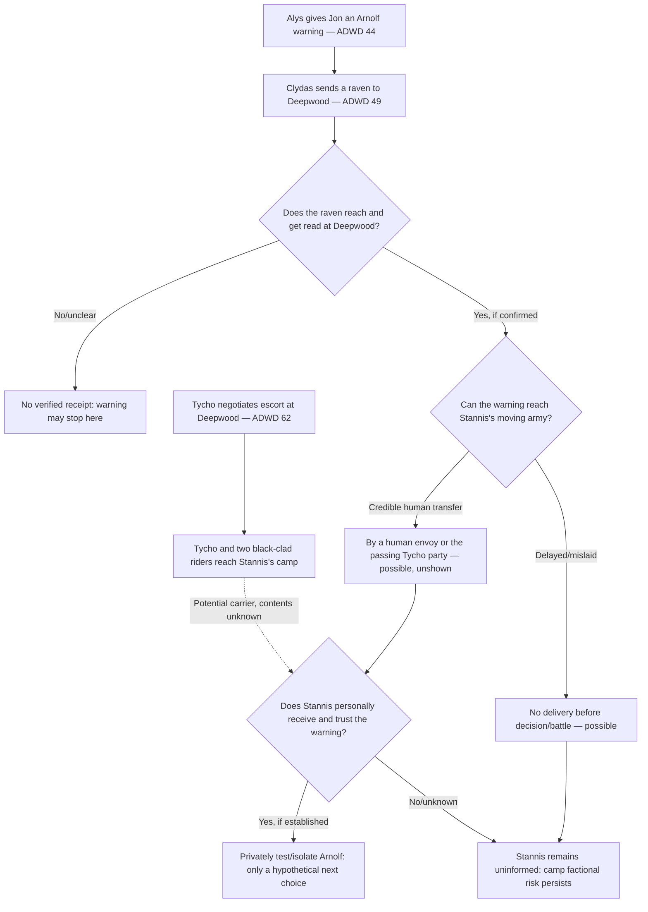

# Arnolf Karstark's betrayal warning — can it reach Stannis before the Battle of Ice?

- Record role: `RESEARCH / SOURCE-TESTED COURIER AND COMMAND AUDIT`
- Primary information class: `FACT / KNOWLEDGE + LABELED COUNTERFACTUALS`
- Status: `PRIMARY TEXT CHECKED / FINAL RECEIPT AND BATTLE OUTCOME UNKNOWN`
- Lifecycle: `ACTIVE`
- Authority: `ADVISORY / NONE`
- Parent: [Synthesis index](README.md) and [Stannis–Theon–Jeyne decision ledger](stannis-theon-jeyne-decision-ledger.md)
- Regional facts owner: [North and Wall chronology](../north-wall-dependencies.md); this document owns only the *interregional warning route* and the consequences for Stannis's next decision.
- Corpus: user-provided five-novel EPUB, specifically ADWD 44, 49, 51 and 62 with ADWD 42/69 as contextual checks; inspected 2026-10-15. Chapter numbers are bundle-local, not printed page numbers.
- Method: distinguish `SEEN`, `HEARD/REPORTED`, `SENT`, `RECEIVED`, `INFERRED`, and `HYPOTHETICAL`. None of the *Winds* sample chapters is treated as part of these five books.

## Bottom line

**Jon's warning is known to have been sent, but Stannis is not shown reading it.** Tycho's route creates a **second plausible human delivery opportunity through Deepwood Motte**; neither that courier path nor a raven forwarding is shown to occur. Asha's scene establishes Arnolf and his independent men are already in Stannis's camp when Tycho arrives, and establishes an internal struggle over whether to march. The *Karhold inheritance motive* is reported by Alys. **The underlying Bolton collaboration is also corroborated by Roose's private remarks in ADWD 32 and Theon's thoughts in ADWD 37**. Neither is information Stannis has been shown receiving. See [claimant audit](winterfell-claimants-stannis-arnolf.md).

**New caution:** Tycho's direct conversation with Jon in ADWD 44 occurs *before* Alys reveals Arnolf's scheme late in the same chapter. Tycho **could not have learned the warning from that initial conversation**. Any claim that “Jon told Tycho the plan” needs an additional later exchange, a message at Deepwood or another explicitly identified contact.

## Source correction: Stannis's preference and Bolton-side corroboration

**ADWD 17:** Stannis explicitly says he favors Arnolf to receive Winterfell, but makes no completed grant. **ADWD 32:** Roose tells Ramsay that Arnolf attempted to bait the Dreadfort trap; **ADWD 37:** Theon expects Arnolf to switch at Bolton's signal. The purpose of this dossier is still the **uncertain delivery to Stannis**, not whether only Alys ever knew the plot. See [competing Winterfell claims](winterfell-claimants-stannis-arnolf.md).

## I. Source-certified partial-order chain

| Node | Book anchor | Established event | What it does **not** establish |
| --- | --- | --- | --- |
| **K1: banker at the Wall** | **ADWD 44 (Jon)** | Tycho asks after Stannis. Jon offers provisions, horses and guides **as far as Deepwood Motte**; from there the banker must find Stannis himself. A loan/ship arrangement with the Watch is discussed. | This meeting does **not** contain Alys's eventual Arnolf accusation. No Stannis warning is handed directly to Tycho here. |
| **K2: Alys arrives** | **ADWD 44 (Jon), later in chapter** | Alys seeks protection against Cregan and asserts that Arnolf pretended to support Stannis while conspiring with Roose. She says Harrion's life and Karhold succession form part of Arnolf's motives. | Her precise succession accusation is motivated testimony, but Roose's ADWD 32 remarks independently corroborate the Bolton connection; the original agreement is not reproduced. |
| **K3: actual dispatch** | **ADWD 49 (Jon)** | Jon explicitly reflects that **Clydas dispatched a raven to Deepwood Motte** to warn the king of Arnolf. Jon does not know whether the bird reached Stannis in time. Tycho has gone off seeking the king with the guides Jon supplied. | Delivery to Deepwood, reading by its commander, forwarding to camp and kingly acknowledgement are all unshown. |
| **K4: northern camp before arrivals** | **ADWD 62 (Asha)** | The army remains stranded near the frozen lakes. Arnolf **arrived eight days earlier** with a son, three grandsons, four hundred spears, forty archers, a dozen mounted lances, his **own maester and cage of ravens**. He has provisions only for his own contingent. | A personal communication capability is not proof the maester sends to Bolton or reads any incoming message. His arrival relative to K3 cannot be exactly dated from these local chapter clocks. |
| **K5: internal access to king** | **ADWD 62 (Asha)** | Stannis emerges from the watchtower for the four cannibals' execution with Richard Horpe and Arnolf trailing. Afterward Arnolf attempts to follow Stannis, but **Horpe turns him toward the longhall**. | Horpe's action may be routine escort/access control; no statement or private Stannis POV identifies Arnolf as a traitor. |
| **K6: camp council** | **ADWD 62 (Asha)** | At the longhall Arnolf advocates marching on Winterfell, claiming loyalty to Ned, Robb and the supposed Stark daughter; many northmen applaud. Massey challenges the ability of half-frozen men to breach gates. Scout Noseless Ned Woods describes extensive **food-fishing holes** in the lake ice. | An inflammatory, militarily weak recommendation **could** be sabotage, zeal, or misjudgment. The trap/Night Lamp plan and its author remain unshown. |
| **K7: banker reaches camp** | **ADWD 62 (Asha)** | Tycho arrives with freed Ironborn escorts after paying Sybelle Glover a ransom at **Deepwood** and finding Mors Umber below Winterfell. Asha sees **two riders dressed all in black** and identifies them as Watch men; their individual identities are not supplied in this scene. Tycho seeks Stannis; Theon and Jeyne are delivered to Asha. | We are **not** told Tycho received K3 at Deepwood, what either black-clad rider knows, or whether the party has met Stannis by the chapter end. |
| **K8: later claim of defeat** | **ADWD 69 (Jon)** | A pink-waxed letter signed Ramsay asserts Stannis is defeated. | Neither author nor the army's fate is independently certified by its arrival. |

### The geographically plausible messenger network

**Raven limitation:** A bird addressed to **Deepwood** is not a bird addressed to a moving lakeshore watchtower. A second relay requires a prepared bird with an appropriate destination or a rider/escort. The novels do not specify an available return bird for Stannis's field camp. Arnolf's separate cage proves only that **he has ravens in camp**, not that those birds connect to Deepwood, Castle Black, Karhold or Bolton.

## II. Four transmission hypotheses with disconfirmers

| Hypothesis | Why it remains possible | Weakest link | Reject / downgrade when |
| --- | --- | --- | --- |
| **T1 — Deepwood receives and forwards via its own rider** | Jon intended a warning to the king; Deepwood was his known recent position and holds Stannis-aligned personnel. | No messenger/response depicted between Deepwood and the lakes. | An identified courier cannot have left or Stannis is shown not to know until after battle. |
| **T2 — Warning is passed to Tycho at Deepwood** | Tycho actually **passes through Deepwood** and pays Sybelle Glover to release escort riders; two black-clad men are in the eventual party. | **No text says Sybelle received K3, handed it over or understood it**. Tycho's *initial* Jon conversation predates Alys's accusation. | A later meeting establishes Sybelle did not receive it, or shows the banker never heard it. |
| **T3 — Another Watch rider carries it** | Jon arranged guides, and Asha recognizes two black-clad men among Tycho's riders. A watch courier would be an intelligible route. | Their **names, task, access and any letter are unknown**. Black clothing alone does not supply their personal testimony. | Identifying them as having no connection to the warned Deepwood garrison, or no message to carry. |
| **T4 — No usable warning reaches Stannis before combat** | Jon voices uncertainty; blizzards immobilize riders; Deepwood is far from the current camp. | Lack of depicted receipt is not proof of nonreceipt; a later POV might reveal it was delivered off-page. | An on-page confirmation Stannis had Jon's message before his decision. |

**Audit finding:** **None of T1–T4 is proved**. The combination “banker + Deepwood + black-clad escorts” is a **genuine plausible path**, not evidence sufficient to select that path. No claim is made about a precise courier time or days-to-arrival.

## III. Why Arnolf is dangerous even without a successful signal

### The succession motive exists separately from battlefield trickery

**ADWD 44:** Alys asserts her older brother Harrion holds the rightful Karhold title if alive; if he dies, **she** precedes her uncles, yet Cregan aims to marry her. She alleges Arnolf's ostensible Stannis allegiance is designed to provoke the Lannisters into killing Harrion. **ADWD 49:** Jon arrests Cregan and marries Alys to Sigorn of Thenn, creating another challenger to Arnolf's preferred succession. Alys's legal/marital survival provides her motive for accuracy and for selective exaggeration; check both.

**ADWD 17:** Stannis tells Jon he is more inclined to give Winterfell to Arnolf. This is a stated preference, not a grant. **ADWD 62:** Asha hears a consistent rumor Arnolf would gain Winterfell; it does not prove any appointment was formalized. The proposed prize would be politically awkward beside Stannis's public use of Ramsay's purported “Arya” marriage grievance and Manderly's separate Rickon ambitions. No need to invent an actual Stannis promise.

### Arnolf carries a faction, not just a dagger

- His party contributes roughly 452 listed fighters (400 spears + 40 archers + 12 mounted lances) plus family and supporting specialists; not all need share his disloyalty.
- His supplies only feed **his own** men; the larger army is starving. Preemptive arrest might spark mutiny among a northern contingent and erode Stannis's support among other northmen.
- His son and grandsons advocate infeasible quick siege solutions in the hall. This creates an *observable strategic reason* for a prudent Stannis to resist their advice **without ever having received Jon's warning**.
- The southron/northern divisions are visible at the longhall: northmen applaud his call to march, while Massey mocks the improvised rams/ladders/towers. A humiliating accusation of betrayal without proof could unite hungry factions **against** Stannis.
- Horpe's diversion of Arnolf away from the tower is important **access-control evidence**, but does not prove Stannis already distrusts him.

### New communication risk created by his own retinue

The Karstark maester and ravens are **an independent possible intelligence channel**. If Stannis receives a warning, a careful commander might separately monitor the maester, ask where his birds are trained to fly, control what news about Theon/Jeyne circulates, and separate innocent soldiers from the accused family. These are **conditional actions**, not a narrated order or proof of a Bolton spy network.

## IV. Three branch tests inside Stannis's first audience

These elaborate, rather than replace, [the original three-way ledger](stannis-theon-jeyne-decision-ledger.md).

### W1 — Warning reaches him, and he believes it

**First choice:** Hear Tycho's business and Theon's account in a small company; silently assess what Jon/Alys alleges against a large allied commander, rather than denounce Arnolf before 450 armed northerners.

**What he may learn:** Alys reports motive and intended betrayal; Theon can independently describe Roose's separate sortie **orders** and Jeyne's imposture, but cannot corroborate Arnolf's private bargain. Sybelle/Tycho would need to explain how the warning came into their hands.

**Costs:** Isolating Arnolf and his communications risks losing manpower, angering his sons and deepening faith/northern divisions. Keeping the report secret leaves Theon/Jeyne vulnerable to interception and forces Stannis to decide whether to mislead his own commanders.

**Counterexample/rejection:** A Stannis who has no credible receipt cannot make an elaborate plan **specifically knowing Arnolf betrayed him**. Also reject an effortless purge of hundreds or a guaranteed tactical lake victory.

### W2 — A delayed or ambiguous warning reaches him

**First choice:** Investigate discrepancies rather than pronounce guilt: ask what Arnolf's troops know, whether the maester has received/sent letters, whether scouts witnessed hostile movements, and what Theon actually heard at Winterfell.

**What he can still decide:** Assign Horpe or another reliable officer to control audience access; avoid letting one interested lord dictate a suicidal siege timetable; protect the girl and banker without asserting her identity publicly.

**Costs:** Every hour costs food; a false denunciation could squander his only large fresh northern reinforcement. Keeping suspected men in camp maintains vulnerability.

**Counterexample/rejection:** Arnolf urging attack is not sufficient proof of treachery; likewise Horpe redirecting him once is not a secretly revealed warrant.

### W3 — No warning, or it arrives after combat begins

**First choice:** Stannis must deal with what the camp **actually** tells him: starvation, brittle ice, disputed marching plans, a suddenly arrived banker and abused captives. He can reject Arnolf's impractical advice on military grounds without any treason hypothesis.

**What he can learn from Theon/Jeyne:** Bolton sortie orders, a false “Arya,” and the fact that some infiltrators helped the escape — all independent of Arnolf's allegiance.

**Costs:** Arnolf retains freedom to sabotage at a dangerous moment; premature disclosure of Jeyne's real name could reach the wrong ears. It is uncertain whether Stannis can distinguish enemy attack from betrayal before the event.

**Counterexample/rejection:** Do not let readers' knowledge of Alys, Jon's raven or the Pink Letter become secret knowledge in Stannis's viewpoint. A battlefield surprise may simply be surprise.

## V. First-audience questions that actually distinguish these branches

1. **Ask Tycho:** What was your route after Castle Black? Who did you meet at Deepwood? Did anyone give you letters or urgent information for the king? *(Questions a commander could ask; no answers are yet narrated.)*
2. **Ask the two black-clad riders:** Who are you, and did the Watch or Deepwood officials entrust you with any warning? *(They are observed by Asha but not named in ADWD 62.)*
3. **Ask Theon:** Which gate did Roose assign Hosteen and Wyman to; was Wyman injured; what does Ramsay believe about the missing girl? *(He may know the orders but not subsequent troop movements.)*
4. **Ask Jeyne with care:** What name were you born with? Is there anyone who can confirm it, and how may the court protect you from being returned? *(Her traumatic circumstances constrain reliable testimony; she should not be forced into another political performance.)*
5. **Ask a Deepwood scout or officer:** Do you know whether a raven from Castle Black came? *(Noseless Ned Woods is identified in ADWD 62 as a scout from Deepwood, but **not** as a courier or a recipient of the warning.)*
6. **Examine Arnolf's command claims:** Why must Stannis march now? Which promised bridges, siege tools, or supply routes are actually available? *(This can be tested even with no accusation.)*

## VI. Strategic conclusion

**The most useful turning point is not that Stannis “discovers a traitor” on cue. It is whether he behaves as a commander who can distinguish independent evidence from convenient agreement.** Alys's warning, Theon's Bolton observations, Jeyne's true identity, Tycho's financial mission and Arnolf's promised Winterfell are different kinds of information, with different incentives and uncertain routes.

The presence of a **named real courier path** through Deepwood raises the plausibility that Jon's warning might reach Stannis **without requiring authorial magic**. At the same time, the chapter's explicit uncertainty and the lack of an audience forbid promoting that possibility to certainty.

**Recommended working scene test:** Stannis begins by questioning Tycho privately about his route and his business, then separately hears Theon/Jeyne with Asha present or under protection. If Tycho has a warning, Stannis must authenticate it and weigh risks; if not, he can still interrogate battlefield information and contest Arnolf's impractical counsel. Both outcomes generate strong political consequences. This is `SPECULATIVE / REVISABLE`, not a selected canonical continuation.

**Reverse outbound correspondence risk (2026-10-16):** [Stannis first-hearing and safe reporting](stannis-theon-jeyne-testimony-and-safe-reporting.md) underlines an unexamined confidentiality issue: **ADWD 62 (Asha)** describes **a maester and cage of ravens belonging to Arnolf's own retinue**. The only clearly itemized raven equipment physically at the crofter-village force therefore belongs to a suspected Bolton collaborator; this does **not** establish that Stannis lacks other maesters, has assigned that maester his letters, or that Arnolf intercepted anything. A future Theon disclosure of Roose's ADWD 32 discussion of Arnolf could be spoiled if conveyed openly through Arnolf's people. **Theon has not yet testified** and the existing **Castle Black→Deepwood warning** remains a separately **DISPATCHED / receipt UNKNOWN** message.

## Next research gate

- **Priority 1:** Investigate whether any text outside ADWD 44/49/62 **within the five published novels** independently records Deepwood receiving a raven from Jon. Current checked passages do not.
- **Priority 2:** Reconcile Arnolf's camp rumor of receiving Winterfell with Stannis's own stated intended Stark claimant. Treat Asha's report as **rumor** unless independently corroborated.
- **Priority 3:** Test how Boltons would exploit a captured/forged warning (separate from Pink Letter) without assuming they have read Jon's raven.
- **Priority 4:** Research a narrow scene of Stannis's first audience before deciding whether Night Lamp tactics are even proposed. Leave enemy arrival and battle outcome unknown.

**Disposition:** T1–T4 and W1–W3 all open. **No winner, anti-Karstark purge, secret courier, raven network or lake trap has been adopted.**

## New Wall witness lead — after the original Deepwood warning

**ADWD 49 (Jon)** explicitly has Jon tell Cregan that **two of Cregan's men** now serve Alys and confirmed Arnolf's plans involving Ramsay. This corroboration belongs to a **different, later knowledge event** than Alys's initial ADWD 44 warning; the **same ADWD 49 chapter** recalls Clydas's previously dispatched warning to Deepwood. The novel never shows a new raven containing the defectors' testimony being dispatched, read at Deepwood or delivered to Stannis. Keep two candidate messages separate:

- *Initial message*: Jon's warning of Arnolf's alleged treachery (`SENT TO DEEPWOOD`); precise contents and receipt unshown.
- *Additional witness report*: two former Cregan escorts support Alys's testimony (`KNOWN TO JON AS REPORTED`); **no later dispatch shown**.

See the [Karstark household evidence map](karstark-household-split.md) before treating Wall defections as a field-camp intelligence asset.
