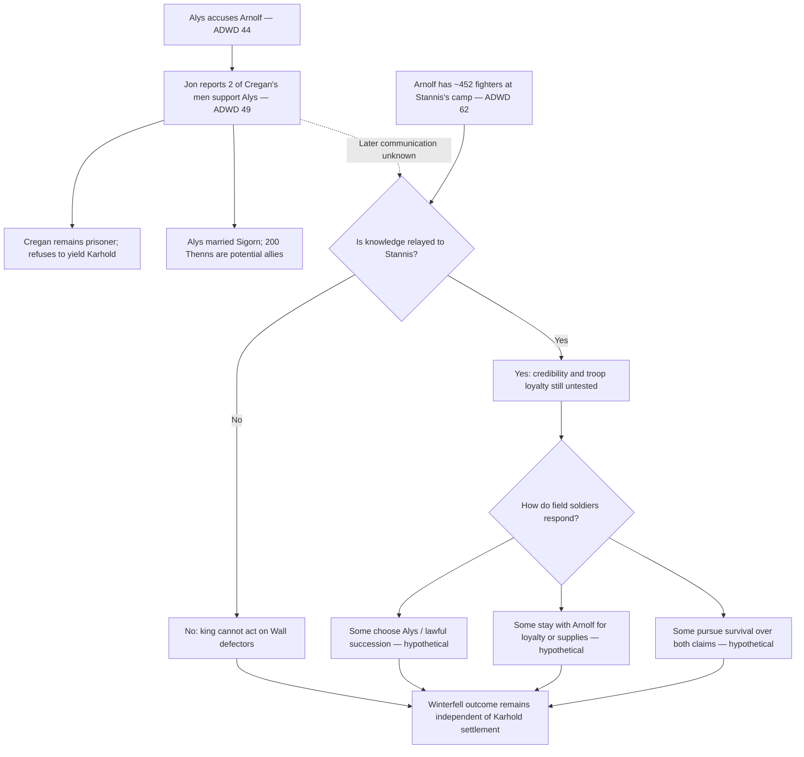

# Karstark household loyalties — two defectors, a disputed castle, and an untested field army

- Record role: `RESEARCH / INDEPENDENT SOURCE CORRECTION + CROSS-THEATER SYNTHESIS`
- Primary information class: `FACT / TESTIMONY / REPORTED BELIEF / CONDITIONAL OUTCOMES`
- Status: `FIVE-BOOK SOURCE AUDIT / NO KARSTARK MUTINY ADOPTED`
- Lifecycle: `ACTIVE`
- Authority: `ADVISORY / NONE`
- Parent: [Synthesis index](README.md)
- Depends on: [Karstark command-fracture audit](karstark-command-fracture.md), [Arnolf warning route](arnolf-warning-routing.md), [Winterfell succession](winterfell-claimants-stannis-arnolf.md), [information handoffs](information-handoffs.md)
- Source examined directly: *A Dance with Dragons* **17 (Jon), 32 (Reek), 37 (The Prince of Winterfell), 44 (Jon), 49 (Jon), 62 (The Sacrifice)** from the owner-provided five-book EPUB; cross-checked on 2026-10-15. Citations are chapter-local, not print pages. No *Winds* previews or TV-derived outcomes.
- **Revision of prior research:** The earlier assertion that the text has *almost no testimony from ordinary Karstark followers* needs narrowing. **ADWD 49 gives two men from Cregan's escort as already having sworn to Alys and confirmed a Bolton-related plan.** There is still **no corresponding direct evidence** that Arnolf's much larger army at Stannis's camp has split or that its soldiers know the plot.

## Principal finding — one household fracture is already established

**ADWD 49, Jon's audience with the imprisoned Cregan:** Jon says **two of Cregan's own men have sworn service to Alys and confirmed what she said about Arnolf's plans with Ramsay Snow.** This is important **on-page testimony about a report**, not an invented future defection.

The precise evidentiary level is `JON REPORTS TESTIMONY`: Jon makes this statement directly to Cregan. The novel does **not** furnish an independent POV scene in which the two men narrate the conspiracy, their exact names/ranks, signed written depositions, or the means by which they learned Arnolf's plan. Nor does it demonstrate that Cregan, Arnolf or Stannis has separately verified the testimony. Jon could conceivably be using coercive bargaining pressure, but the text supplies **no affirmative reason** to call his account a bluff.

This gives at least **three independent-looking channels** to test, each with limits: (a) Alys's accusation in **ADWD 44**; (b) Jon's **report of two defectors' corroboration** in **ADWD 49**; (c) the Boltons' internal account overheard by Theon in **ADWD 32**, with Theon's inference in **ADWD 37**. Alys and the two defectors are likely sharing knowledge of the same underlying Karhold scheme; two persons confirming her account are not automatically two wholly independent origins. Theon's later thought also need not be independent of his earlier overhearing.

## Who exactly belongs to which Karstark group?

| Group / locale | Five-book source and what is directly established | Known allegiance or claim | **Not** established |
| --- | --- | --- | --- |
| **Cregan's small pursuit escort, near the Wall** | **ADWD 49:** Cregan arrives behind Alys with **four mounted men-at-arms, a huntsman and dogs**; one of his men shoots at Ty and is killed. Jon has the others put in ice cells. | **Jon later says two of Cregan's men** have transferred their service to Alys and supported her account of the Bolton plan. | The men's names; whether both came from the four mounted fighters or one was huntsman; the status, beliefs or future of the other survivors. |
| **Cregan himself, captive at Castle Black** | **ADWD 49:** insists his father is lord, asserts Harrion is dead, scorns Alys's marriage, refuses to relinquish Karhold and is threatened with possible royal execution or the black. | Explicitly loyal to Arnolf's hereditary claim **as he states it**. | That his assertion of Harrion's death is independently confirmed; that every man in his following shares his position. |
| **Alys Karstark, now wife of Sigorn** | **ADWD 44/49:** explains the succession dispute; marries Sigorn under Melisandre's rite; believes Karhold would open to her; Jon says two of the pursuing men swear to her. | Competing dynastic claimant (after Harrion, **if he dies**) and a rallying point. | Castle garrison has actually declared for her; the promised reception by Karhold has occurred; Stannis or northern lords accepted the marriage politically. |
| **Sigorn's Thenns at the Wall** | **ADWD 49:** Jon says Sigorn leads **two hundred Thenns** and offers the marriage as protection and a future Karhold option. | A potential armed marital constituency attached to Alys. | They are at Stannis's lake camp; they can march through winter to Karhold in time; local northerners will accept Free Folk rule. |
| **Karhold's resident household and civilians** | **ADWD 49:** Alys describes years of war draining able workers, failed harvests and impending starvation. Jon promises that she may pardon **women who betrayed her**, while male conspirators could take the black. | Some servants or household figures aided Arnolf/Cregan, according to the accusations; Alys hopes others will support her lawful claim. | A signed garrison manifesto, named loyal castellan replacing Arnolf, civilian consensus, a secure food surplus. |
| **Arnolf's army at the crofter's village** | **ADWD 62:** arrives with **400 spears, 40 archers and 12 mounted lances** (roughly **452 described combatants**), a son, three grandsons, a maester, a raven cage and **provisions only for its own use**. | Arnolf and family publicly advocate marching; the camp northmen loudly approve his speech invoking Ned, Robb and the false Arya. | The rank and file have been briefed on his pact with Roose; every fighter would obey a betrayal order; any soldier has defected at Stannis's camp. |
| **Northern clan lords and followers (distinct)** | **ADWD 49/62:** Flint, Norrey and other Northmen differ from Arnolf's own retainers. Elder Flint/Norrey visit Alys's wedding; their younger kin fight with Stannis. | Strong concern for Stark and Old Gods traditions, with varying tolerance for the marriage rite. | They are command authorities over Arnolf's spearmen or can issue binding orders to Karhold. |

### Size and identity audit

- The **two defectors** are a **subset of Cregan's *small* escort at the Wall**. They cannot be divided by Arnolf's **452 men** to calculate a “desertion rate.”
- Cregan's escort includes **four mounted men-at-arms *plus a huntsman***; the man killed is not identified by role in the wording. We cannot authoritatively describe a precisely numbered surviving guard breakdown beyond those stated.
- Jon's reported witnesses confirm **plans involving Arnolf and Ramsay Snow**, not all subsequent stages of the battle or every reported Karhold murder motive.
- Arnolf's soldiers' belief system cannot be simply inferred from **Asha's** statement that the Karstarks worship the Old Gods: she frames that as her own understanding (**ADWD 62**), not interviews with 452 soldiers.
- The men stamping at Arnolf's speech are described by Asha as **mostly northmen**; she does not identify them all as members of Arnolf's regiment. Their applause proves widespread impatience with delay, **not knowledge of treachery**.

## The political alternative is real but harder than “Alys is rightful lord”

**ADWD 44:** Alys describes Harrion as the rightful lord; Arnolf is his castellan. Her claim arises **after** Harrion, if his death is established. Cregan wants to marry her to consolidate his father's line. **ADWD 49:** Cregan **asserts** Harrion is dead; Jon's response treats that as unverified. Therefore a scene cannot lawfully and conclusively call Alys “the current Lady of Karhold” **on this evidence alone**.

**ADWD 49:** Alys is **already married to Sigorn**, and Jon proposes that Cregan yield the castle, the implicated women obtain pardon, and implicated men may take the black. This offers a potential route other than mass execution. It does not prove the garrison will accept the terms, or that the marriage has transformed northerners' view of wildlings.

**ADWD 49:** Alys also explains that the home harvest failed because her father's campaign removed productive labor, while Jon's worries for old people and children introduce a different loyalty test: who can **feed** Karhold through winter? A claim that the rightful claimant automatically commands men without provisions ignores the existing humanitarian and subsistence crisis.

### Important cross-theater constraint

Jon at the Wall knows about the reported two defections. Stannis far south may receive a prior warning via Deepwood (**ADWD 49** recalls Clydas's dispatch), and he might learn what Theon heard from Roose (**ADWD 32**). **Neither source says Jon sent Stannis an updated report that included the two escort men's later testimony**. Treat this as a newly available *potential* messenger route, not an accomplished communication.

Elder Flint and the Norrey **attend the wedding** while relatives participate in Stannis's campaign. That is a credible social route for **future** knowledge transmission, but no scene establishes that they report the defectors' testimony, can reach the lake camp, or speak for Arnolf's troops.

## Three narrower hypotheses about field-army loyalty

| Branch | What would make it plausible | Evidence that currently weakens it | Reversal / rejection condition |
| --- | --- | --- | --- |
| **H1: Family command retains cohesion** | Arnolf has food, named kin and 452 troops; loyalty may attach to his pay, customary rank or household. | Two men from Cregan's escort already abandoned the family line; Arnolf's title and inheritance are challenged. | Downgrade if multiple field soldiers identify Alys as their lawful superior, refuse commands or offer independent testimony. |
| **H2: Some soldiers distinguish lawful Karhold loyalty from Arnolf** | The escort's two reported defectors demonstrate at least *some* capacity to change allegiance; Harrion/Alys have plausible succession claims and historical ties to Starks. | No one at the crofter's village is depicted renouncing Arnolf or hearing the defectors' story. | Downgrade if troops explicitly say they knowingly support Roose's trap; upgrade with *named camp witnesses* or a credible letter. |
| **H3: Most soldiers simply want survival and supplies** | They have provisions reserved for themselves while Stannis's wider army starves; their homes face severe harvest failures. | No soldier-level interview gives those motives, and Arnolf's address frames action as loyalty to Ned and Robb. | Downgrade if officers' testimony makes clear that the rank and file knowingly accepted a political/religious commitment despite risks. |

**No percentage confidence:** The one proved small-group division cannot establish any population-wide rate. The strongest inference is **the Karstark political apparatus isn't monolithic**; the actual Stannis-camp battalion remains **unobserved as individual consciences**.

## Conditional branches for Stannis, revisiting [command fracture](karstark-command-fracture.md)

1. **Witness-protected offer, not automatic purge.** If Stannis hears about the **Wall defectors** through an authenticated courier *or* believes Theon's separate Bolton testimony, he may confidentially offer Arnolf's soldiers protection if they refuse illegal orders. This requires a trusted intermediary and credible means to pay/feed them; neither is established.
2. **Command containment while evidence develops.** Stannis could keep Arnolf's kin out of the most sensitive planning and use existing escorts/guards for a limited watch, but any abrupt demotion risks alerting the family. No particular Karstark captain is known willing to replace them.
3. **No received defector news.** Stannis may never learn of the two men at Castle Black before combat. His judgment would rest on Arnolf's observable conduct, Theon if interviewed and any Jon/Deepwood message. The **reader** still knows the Karstark household is divided.

### Human and ethical checks

- Alys's right to refuse an incest-adjacent forced marriage and Cregan's intimidation are real personal stakes; she is **not just a banner that can be raised to win a battle**.
- The two switchers may face reprisal if named or returned to Arnolf. A scene that leaks their location without safeguards undermines its own claim to justice.
- The 452 field soldiers include people whose motives we cannot narrate from an existing POV without a justified encounter. A swift “they all defect” or “they all betray Stannis” would be an **unearned certainty**.
- **Harrion's status must be reverified** before anyone declares Alys or Cregan the uncontested legal heir.
- The Karhold civilians, elders and children are facing hunger regardless of whether an army wins at Winterfell.

## Working consequence map

## Next independent review questions

- Are Jon's two defectors **separately identifiable** anywhere else in the five novels? In the checked ADWD 49 scene, **no**.
- Is there any actual **message after their change of allegiance** that names them for Stannis? The source-checked passages do not show one.
- Does Stannis ever recognize **Harrion's** legal right while considering Arnolf for Winterfell? His ADWD 17 preference is based on alleged loyalty and descent, not a demonstrated inquiry into Karhold inheritance.
- Can Sigorn's Thenns travel safely to Karhold, and who could feed them there? Neither an executed campaign nor acceptance by the castle is shown.
- After Jon's final ADWD 69 stabbing, does anyone else at Castle Black know the two defectors' identity and testimony? **UNKNOWN**; Jon may not be the only recipient but no second source is named.

## Source-audit conclusion

**Verified in the text:** Jon directly **reports** two members of Cregan's escort have sworn to Alys and corroborated plans between Arnolf and Ramsay. Cregan resists, Alys is married with a conditional claim and support from Thenns, and Arnolf's larger battalion is separately present with Stannis.

**Reasonable inference:** Arnolf cannot presume *every person associated with Karhold* will follow his plan; loyalty can splinter around lawful succession, protection and winter survival.

**Not established:** A split in the 452-man lake contingent, universal Stark allegiance, successful Thenn seizure of Karhold, a written deposition, receipt at Stannis's camp, or the fate of Harrion.

**Disposition:** `PRIMARY CLAIM CORRECTED; FIELD-ARMY LOYALTY OPEN; THREE BRANCHES RETAINED`. Any continuation must treat the **two at the Wall** and **the 452 near Stannis** as distinct populations.
