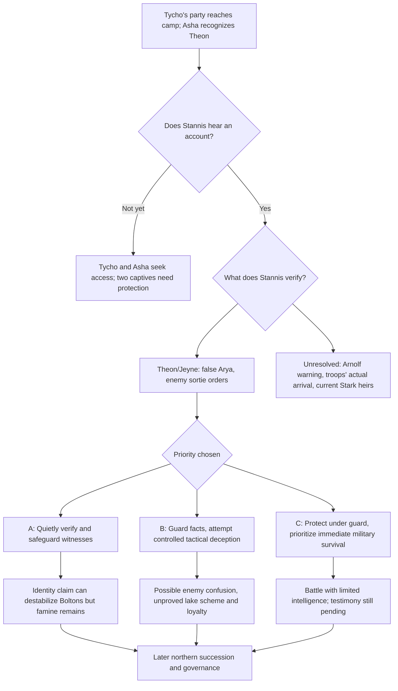

# Stannis, Theon and Jeyne — the first decision at the crofter's village

- Record role: `RESEARCH / THREE-WAY CAUSAL BRANCH LEDGER`
- Primary information class: `FACT / KNOWLEDGE + PROVISIONAL STORY EXPERIMENTS`
- Status: `PRIMARY TEXT AUDITED / OUTCOMES UNCHOSEN`
- Lifecycle: `ACTIVE`
- Authority: `ADVISORY / NONE`
- Parent: [Synthesis router](README.md)
- Input: [Winds opening architecture](winds-conditional-architecture.md), [handoff ledger](information-handoffs.md), [North/Wall chronology](../north-wall-dependencies.md), [Theon/Asha/Stannis](../characters/theon-asha-stannis.md), [Stark identities](../continuity/stark-children-information.md)
- Source: five published novels in the user's EPUB, re-examined **2026-10-15**; ADWD 44 (Jon), 49 (Jon), 51 (Theon), 62 (Asha), with targeted ADWD 29, 41 and 69 cross-checks.
- Scope: A source-based decision test, **not** the other agent's sequential chapter notes or a new published `Winds` chapter.

## Executive finding

**Theon and Jeyne arrive at the *camp*, not yet at a narrated audience with Stannis.** ADWD 62 ends when Asha recognizes the broken man as Theon after Tycho Nestoris and a northern escort deliver two people to her. Tycho asks to meet the king; Asha directs him toward the watchtower. No conversation with Stannis, identification of Jeyne to him, interrogation of Theon, or command for a lake trap follows in this five-book chapter.

**The next real decision belongs to several people, not one:** Stannis must decide whom to admit, whom to believe, and whether the camp can afford to wait; Theon must decide how much to confess or reveal; Jeyne must decide whether she can risk contradicting her imposed identity; Asha must decide whether she can shield her brother or the girl; Arnolf has a plausible motive to prevent the king hearing damaging news, but no narrated opportunity to intercept them yet.

## I. Verified arrival and sequence (avoid false simultaneity)

| Book scene | Evidentiary class | What actually happens | Boundary |
| --- | --- | --- | --- |
| **ADWD 32/37 (Theon)** | `HEARD/INFERRED BOLTON-SIDE` | Roose tells Ramsay Arnolf tried to lure Stannis into a Dreadfort trap; Theon later thinks Arnolf will turn at a Bolton signal. | Strong corroboration for the reader; no testimony has been supplied to Stannis and no original signed pact is shown. |
| **ADWD 44 (Jon)** | `REPORTED TO JON` | Alys Karstark says Arnolf allied with Roose and intends to betray Stannis; she names the Karhold inheritance/forced-marriage motive. | Alys is a highly motivated witness, but Jon has not observed a betrayal; neither she nor Jon is present at the crofter's village. |
| **ADWD 49 (Jon)** | `DISPATCHED` | Jon recalls Clydas sending **a raven to Deepwood Motte** warning Stannis; Jon explicitly does not know if it reached him. | Deepwood is not Stannis's current camp. Forwarding/receipt remains unobserved. |
| **ADWD 51 (Theon)** | `OBSERVED ORDER` | After Little Walder's death triggers a Frey–Manderly bloodbath, Roose reads a raven report of Stannis's hunger/location and orders **Hosteen's Freys to the main gates** and **Wyman's White Harbor men to the east gate**. | These are *orders*, not confirmed times/arrivals, and Theon has not told Stannis. The sender of Roose's raven is unknown. |
| **ADWD 51 (Theon)** | `OBSERVED ESCAPE` | Theon helps Jeyne Poole, falsely called Arya, escape; Holly is hit on the walls, other rescuers' fates remain unshown; he jumps with Jeyne. | They have not brought out a signed confession, verified identity document, Stark heir or complete list of rescuers' fate. |
| **ADWD 62 (Asha)** | `OBSERVED CAMP CONDITIONS` | Stannis's host is snowbound near two lakes; fishing has thinned; the ice has many holes; horses have dwindled; religious factions feud; four cannibals are burned on the king's order. | Holes were made **for food**, not yet depicted as planned military works. Asha interprets Stannis's solitude at the watchtower but cannot read his mind. |
| **ADWD 62 (Asha)** | `OBSERVED ALLIED ARRIVAL` | Tycho arrives with Tristifer Botley and other freed ironborn escorts; says Sybelle Glover accepted a ransom and that **Mors Umber gave them the two captives**. The girl is frostbitten and terrified; Asha identifies Theon after he calls her sister. | We have **a delivery to Asha in camp**, not a direct delivery to Stannis or a completed interrogation. Tycho's claim about Mors is his report; she did not watch that exchange herself. |
| **ADWD 69 (Jon)** | `RECEIVED UNSUBSTANTIATED CLAIM` | A letter signed Ramsay later alleges the destruction of Stannis and demands bride and 'Reek' among others. | A later letter's claims do **not** retroactively prove Stannis lost the battle or identify its author. ADWD POV order does not supply a universal synchronized day/date. |

### Four little facts that change the chessboard

1. **Two men from the Night's Watch are among the incoming riders** (ADWD 62). That is visible to Asha but not independent proof they carry Jon's warning or know Arnolf is treacherous. Their names, message instructions and exact role at this arrival require source verification.
2. **Tycho purchases escort freedom** (ADWD 62). He has political/financial business for Stannis. He is *not* shown signing a loan or presenting terms in this chapter. A banker with outside leverage becomes another immediate appointment competing with a prisoner interview.
3. **Asha sees deep frostbite on the girl's nose and extensive damage to Theon** (ADWD 62). Even an intelligent commander cannot treat their testimony as a cost-free interrogation, ignore treatment, or assume either has a complete account.
4. **Theon heard Rowan deny involvement in Little Walder's murder** (ADWD 51). He suspects the washerwomen but lacks direct proof of the child murderer's identity. A future deposition must not identify an assassin based on that accusation.

## II. The proposed information interview: what can actually be learned

| Question Stannis or a lieutenant might ask | Which person might answer, based on observed knowledge? | What a careful answer could and could not establish |
| --- | --- | --- |
| Is Ramsay's bride actually Arya Stark? | **Theon**: he knew Jeyne Poole before the imposture and was forced to support her identification (ADWD 37, 51). **Jeyne**: the victim herself can give her name if safe enough. | `STRONG PROBABLE TESTIMONY`: Jeyne is not Arya. **No testimony yet delivered to Stannis**. Her fear might constrain truthful speech; a false identity can be politically useful to captors. |
| Which enemy troops are moving, and why? | **Theon**: heard Roose's ADWD 51 orders, saw the hall violence and his own escape; possibly can reconstruct gate assignments. | `FIRST-HAND ABOUT ORDERS`, not verified enemy arrival, exact head counts, field routes or continued loyalty. |
| Who was killing Bolton/Frey men inside Winterfell? | **Theon**: saw effects and some killers' motives, but not all murders; washerwomen **deny** Little Walder's murder (ADWD 51). | Useful leads, not identification of every killer or proof the Manderlys were guilty. |
| How does Ramsay use the supposed Stark girl? | **Theon and Jeyne**: direct experience of the marriage fraud and abuse. | Explains the symbolic value of Bolton's marriage; the two witnesses may be traumatized and face retaliation if returned. **No rescue automatically implies a legitimate replacement Stark is available**. |
| Can Arnolf Karstark be trusted? | **Alys/Jon**, far away, have the explicit warning. **Theon** hears Roose's ADWD 32 account of Arnolf's trap and privately anticipates betrayal in ADWD 37, although he has not witnessed an original formal pact; **Jeyne** has no equivalent established knowledge. | The arrival does **not itself** give Stannis proof of Arnolf's treason. He could hear Theon's Bolton-side account in a **new audience**, or receive Jon's warning; neither is shown reaching Stannis by ADWD 62. |
| Where are the real Stark children? | **Theon** knows Bran/Rickon were *not* the miller's sons he used as corpses in ACOK, and has relevant Winterfell background; **Manderly/Wex/Davos** separately know a possible Rickon/Skagos lead (ADWD 29). | Do not infer Theon knows Rickon's actual present location or can authenticate Davos's mission. His own crimes complicate his testimony. |
| Did Mance or his companions survive the escape? | **Theon** knows Abel and spearwives organized the effort and saw Holly's death, but lost the other rescuers in the snow (ADWD 51). | He can describe a singer named Abel; **Mance's true identity and his fate** are not necessarily known to him or Stannis. |
| Are the lake ice, beacon and blizzard tactically exploitable? | **Scouts/Noseless Ned** describe many fishing holes and uncertain ice (ADWD 62); Asha sees the beacon. | Physical hazards are verified. No source says Stannis designed these conditions as a trap or knows Davos's Sisterton false-light story (ADWD 9). |

## III. Three genuine, reversible immediate branches

### Branch A — Quiet verification and protection before an assault

**NEXT CHOICE (SPECULATIVE):** Stannis limits the audience to Tycho, a trusted officer, Asha and the rescued two; seeks corroboration of Jeyne's identity before public announcement; sends her for treatment and attempts to keep Karstark retainers away from her testimony.

- **Grounded motive:** Theon can challenge Bolton's Stark legitimacy, but the king also needs accurate intelligence; Stannis's claim to impose lawful order is easier to sustain if he protects an abused girl instead of re-exploiting her.
- **Immediate cost:** Delay consumes the last horses and food. Other captains may regard coddling enemies/traitors as weakness; Asha and Theon may not immediately trust their captor.
- **Information gain if successful:** Specific gate/sortie orders and a defensible claim that Ramsay's 'Arya' is Jeyne. This does **not** prove Arnolf's treason or recover Rickon.
- **Uncertainty maintained:** Theon may not remember or disclose everything; Jeyne may fear speaking her name; Stannis may prioritize demands from Tycho.
- **Branch rejection condition:** Reject a version in which a long, calm investigation, ample supplies, or a secure neutral medical refuge exists without a source-supported logistical change. Reject any secret, preexisting knowledge of the imposture attributed to Stannis without proof.
- **Possible next cross-POV consequence:** Word of a *possible* fraud circulates among Stannis's northmen; rival houses debate whether the girl is a credible witness or a royal fabrication. Davos/Rickon remains independent.

### Branch B — Controlled tactical deception / selective disclosure

**NEXT CHOICE (SPECULATIVE):** Stannis keeps the rescued girl's actual identity secret while questioning Theon about enemy deployment and Winterfell's defenses. He might deliberately let Bolton's men believe the 'Arya' hostage is still usable, or exploit different gate/sortie knowledge as the enemy comes.

- **Grounded motive:** Survival is urgent; Roose's two sortie orders create uncertainty and potential opportunities. Stannis has previously used deception elsewhere, but this source **doesn't establish** a planned lake trick.
- **Immediate cost:** Deliberate secrecy risks becoming another form of using Jeyne as a piece of property; if Theon lies under fear, the plan fails. Asha could object when her brother or the girl are endangered.
- **Information gain if successful:** First-hand confirmation of Roose's *orders*, not locations; leverage against a Bolton marriage claim; time to examine Arnolf.
- **Uncertainty maintained:** The king has no demonstrated route to lure both enemy contingents onto weak ice. The watchtower beacon may be merely light for allies, and trout holes were cut for food.
- **Branch rejection condition:** Reject any version claiming Theon supplied precise field coordinates, that Manderly captains are secretly on Stannis's side, or that a second beacon was already manufactured on the king's orders. Likewise reject a claim Arnolf has been exposed without a received warning.
- **Possible next cross-POV consequence:** A Frey/Manderly engagement or partial defection may produce prisoners and contradict Bolton's propaganda, but victors still face famine and an unconquered Winterfell.

### Branch C — Prioritize a rapid campaign / postpone the identity question

**NEXT CHOICE (SPECULATIVE):** A newly urgent enemy report or council pressure causes Stannis to postpone sustained questioning, preserve Theon/Jeyne under guard and concentrate on defending or moving his troops. Tycho's offer may become more important than extracting more testimony immediately.

- **Grounded motive:** The army is losing horses and men, the ice is no longer productive, and commanders advocate incompatible choices (ADWD 62). Both a starving delay and a risky advance have real prices.
- **Immediate cost:** Going into battle without investigating false Arya, Arnolf or the Frey–Manderly split discards advantages and could expose the prisoners to Suggs/the queen's men. Tycho is not guaranteed to fund soldiers or magically deliver provisions in a blizzard.
- **Information gain:** Almost none at first; a military outcome might create a chance to interrogate later. That is a **choice**, not evidence that Stannis is careless.
- **Uncertainty maintained:** The source doesn't show an imminent enemy cavalry arrival during the final Asha scene, merely approaching riders who turn out to be Tycho's party.
- **Branch rejection condition:** Reject an exact marching timetable that contradicts the storm and camp conditions or an assumption that the king already knows all the information his captives possess.
- **Possible next cross-POV consequence:** A shaky military engagement might produce hostages, false defeat reports or divided command without anyone authenticating the Stark girl.

## IV. The faith/command problem is independent of the battle trick

**ADWD 62 directly depicts** four convicted cannibals burned on Stannis's order. The religious faction wants more sacrificial fire; Clayton Suggs publicly menaces Asha. Justin Massey and Alysane Mormont argue for her protection; Richard Horpe can threaten fellow commanders over faith. The visible army has dwindled severely in horses; men dispute whether to march, wait or fall back. Arnolf, whose actual intent is **reported elsewhere**, pushes aggressively toward Winterfell.

**Interpretive constraint:** The fact Stannis has approved a religiously inflected punishment does not establish that he would personally order Asha's death next, execute Theon immediately, or accept any queen's man's proposal. Conversely, Stannis's reputation for law is not a guarantee he will protect Jeyne. The decision remains open.

**New observation with high causal value:** The newcomers are delivered just after Asha is threatened. Her recognition of Theon puts familial loyalty inside a fragile army whose captains are already divided over the treatment of prisoners. Asha is thus a **possible negotiating bridge**, not merely a passive observer.

## V. Conditional decision network (no battle winner selected)

The arrows illustrate **possible consequences of deliberate choices**; no node means a future event is already canon.

## VI. Independent challenge — claims a skeptical reader should reject

1. **"Stannis interrogates Theon at the end of ADWD."** No: the chapter stops outside the watchtower with Asha and Tycho's party.
2. **"Stannis's camp knows Jeyne is a fake."** Asha sees a frightened, frostbitten girl; the disclosure to commanders is not narrated.
3. **"Theon could have no evidence of Arnolf's betrayal."** Incorrect: Roose's ADWD 32 comments were made in his presence and ADWD 37 shows Theon expecting Arnolf to turn. **But Stannis has not heard Theon**, and the source does not reproduce Arnolf's signed pledge.
4. **"Theon has full information on every man murdered in Winterfell."** He does not; he had suspicions and was not a witness to all killings. Rowan denies the group killed Little Walder.
5. **"Tycho arrives with ready funds sufficient to save the army."** He is a banker with urgent business, but no loan disbursement or immediate new provisions is shown on arrival.
6. **"Fishing holes prove Night Lamp."** They prove desperate subsistence and unsafe ice; planned cavalry deception needs further evidence.
7. **"Theon's testimony means the real Arya or Rickon has been found."** It establishes a likely fraud, not the genuine heirs' current whereabouts.
8. **"A battle success unifies Northmen."** House Manderly's Rickon bargain, Bolton's hostage politics, Arnolf's suspected betrayal and the will's uncertain legal status remain.

## VII. Recommended next research, not scene-writing yet

- **Highest-value missing scene:** Stannis's actual private reception of Tycho and the two captives. Before any plotted battle beat, decide which character narrates it; **Asha is the only POV physically shown meeting them at the chapter endpoint**, but a later Theon POV would bring first-hand knowledge and a powerful fear of captivity.
- **Operational audit:** Check how Stannis separated Karstark advice, northern scouts and royal knights before the newcomers arrived. Find evidence of any stored documents/ravens, not presumed war-room omniscience.
- **Ethical audit:** Separate Jeyne's legal identity from her safety. A damaged, frightened minor is not a transferable marriage or intelligence asset simply because she is useful.
- **Aftermath audit:** For each branch, ask who feeds surviving soldiers and protects both girl and captive Greyjoys, and who could credibly carry an identity report toward White Harbor or Castle Black.
- **Independent source-tier rule:** Later *Winds* sample chapters can be reviewed in a separate document when authorized, but they cannot backfill the **five published novels' ending**.

**Disposition:** `A, B, C ALL RETAINED`. **Best evidence-supported next movement:** a **brief protective, skeptical audience** (a weak version of A), because witness testimony could change the next choices and the camp cannot afford costly false intelligence. This is a *literary experiment preference*, not a claim Stannis will choose it; competing branches remain valid.

## Which coalition would receive the truth? (2026-10-16)

[Three northern coalitions and the false Arya revelation](northern-coalition-manderly-umber-clans-arya-revelation-gates.md) distinguishes **Manderly**, **Mors/Hother Umber**, and the **mountain clans** rather than presuming one northern response. **Wyman's recognition of Stannis remains contingent on genuine Rickon returned by Davos** (ADWD 29); **Big Bucket Wull** openly combines rescue of Ned's presumed girl with a desire to fight the Boltons even at lethal cost (ADWD 42); **Mors** refuses to fight Hother and demands pardon for him and Mance's skull (ADWD 17). The latter creates a **possible clash** with Jon/Melisandre's secret Mance rescue; no evidence Mors knows the identity of Abel. Even if Stannis privately learns Jeyne is not Arya, neither the field army nor White Harbor automatically does so, and **the Frey/Manderly sortie result is still unobserved** (ADWD 51). The interview branches should retain these *separate* motives and distribution gates.

## First-hearing witness and outward message gate (2026-10-16)

The [testimony and safe-reporting audit](stannis-theon-jeyne-testimony-and-safe-reporting.md) adds a **distinct evidentiary problem** to the existing branches: **ADWD 37 (Theon)** shows Lady Dustin deliberately uses Theon as the supposed Arya's wedding presenter precisely because he grew up with the Stark children. If Theon later exposes **Jeyne Poole**, he must **recant his own coercively performed public authentication**, not simply reveal anonymous court gossip. **ADWD 42 (Asha)** directly records the mountain clans' desire to liberate *Ned's girl*; public correction could delegitimize Bolton's Stark marriage and also strain this part of Stannis's coalition motive. Neither reaction is yet depicted; the actual Stannis hearing is absent.

**ADWD 62 (Asha)** identifies **Arnolf's own maester and cage of ravens** as his contingent's equipment, **not** Stannis's verified secure courier capacity; Asha sees **two unnamed riders in all black** and *infers* Watch association. No oath, courier instructions or post-arrival return journey is supplied. `THEON/JEYNE ARRIVED TO ASHA` → `STANNIS HEARD THEON` → `STANNIS CHOSE DISCLOSURE` → `MESSENGER DISPATCHED` → `JON OR NORTHERN ALLIES RECEIVED` are **five different gates** with only the first source-verified. Theon can report **Roose's gate assembly orders** in ADWD 51, **not** Frey/Manderly field arrival.

## Warning-route companion (2026-10-15)

The [Arnolf warning-route audit](arnolf-warning-routing.md) is the canonical synthesis owner for the four possible routes from Castle Black through Deepwood to Stannis. Its strongest new ordering constraint: **Tycho meets Jon before Alys reveals the betrayal in ADWD 44**, but later travels through Deepwood to the king's camp. The novel never depicts a Deepwood receipt or an audience with Stannis. All three first-audience branches above remain open.

## Additional political checkpoint

[Winterfell succession and Stannis's expressed Arnolf preference](winterfell-claimants-stannis-arnolf.md) adds the independent source evidence in **ADWD 17 and 32/37** and separates a Baratheon **Lord/Warden** appointment from Robb's independent **King in the North** inheritance. This supersedes earlier shortcuts treating Asha's camp rumor and Alys's accusations as the sole sources.

## Command-level evidence audit (2026-10-15)

The [Karstark command fracture dossier](karstark-command-fracture.md) now verifies that **Reek/Theon remains alone with Roose and Ramsay after the ADWD 32 hall is cleared**, and could testify to the **words he heard** if he chooses. His ADWD 37 belief that Arnolf awaits a Bolton signal may arise from those same words: do **not** treat it as an independent second witness. Stannis has **not received** this testimony on-page. The dossier further tests why exposing Arnolf does **not** prove guilt or loyalty among his ~452 retainers and why Stannis could not effortlessly replace their officers.
